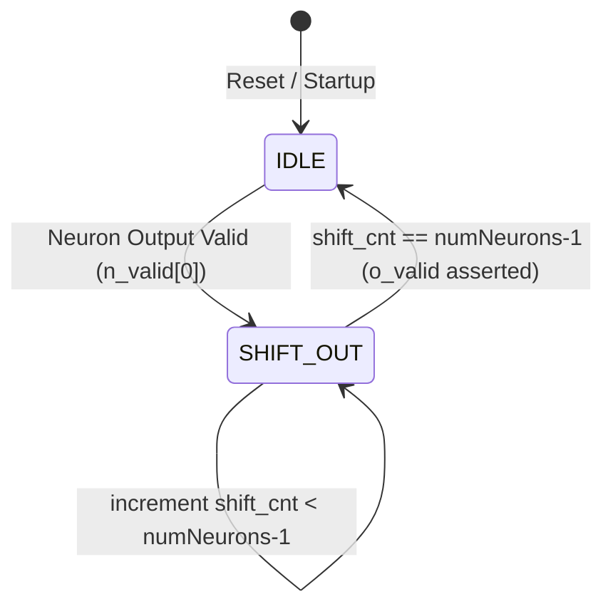

# NeuroSomno-HDL — Architecture & Interface Specification

This document provides the full system design specifications, latency analyses, and register configurations for the **NeuroSomno-HDL** sleep apnea detection accelerator.

---

## 1. Top-Level Pipelined System Diagram

```
      ┌─────────────────────────────────────────────────┐
      │                 Processing System (PS)          │
      │                 ARM Cortex-A9 Core              │
      └─────────────────────────────────────────────────┘
           │ (AXI-Lite Control)           │ (AXI-Stream Data)
           ▼                              ▼
┌───────────────────────┐        ┌──────────────────────┐
│   axi_lite_wrapper    │        │  zynet_top (Stream)  │
│                       │        │                      │
│  - Control registers  │        │  - Input BRAM buffer │
│  - Config registers   │        │  - Streaming FSM     │
└───────────────────────┘        └──────────────────────┘
           │                              │
           │ (wen, waddr, wdata)          │ (s_axis_tdata, valid)
           ▼                              ▼
┌───────────────────────────────────────────────────────┐
│                 Programmable Logic (PL)               │
│                                                       │
│   ┌───────────┐     ┌───────────┐     ┌───────────┐   │
│   │  Layer 1  │────>│  Layer 2  │────>│  Layer 3  │   │
│   │  (ReLU)   │     │  (ReLU)   │     │ (Sigmoid) │   │
│   └───────────┘     └───────────┘     └───────────┘   │
│                                             │         │
│                                             ▼         │
│   ┌───────────────────┐             ┌───────────┐     │
│   │   find_max_out    │<────────────│  Layer 4  │     │
│   │ (Argmax Decision) │             │ (Sigmoid) │     │
│   └───────────────────┘             └───────────┘     │
└───────────────────────────────────────────────────────┘
```

---

## 2. Timing & Latency Analysis

### Clock Cycles per Layer
The network computes layer outputs sequentially in a feed-forward manner. The clock cycle counts for each layer are bounded by the number of inputs and weights processed:

| Layer | Input Size | Neurons | Activation | Clock Cycles (Computation) |
| :--- | :---: | :---: | :---: | :---: |
| **Layer 1** | 784 | 30 | ReLU | $784 + \text{latency} \approx 787$ |
| **Layer 2** | 30 | 30 | ReLU | $30 + \text{latency} \approx 33$ |
| **Layer 3** | 30 | 10 | Sigmoid | $30 + \text{latency} \approx 34$ |
| **Layer 4** | 10 | 10 | Sigmoid | $10 + \text{latency} \approx 14$ |
| **Argmax** | 10 | — | — | $10 + \text{latency} \approx 12$ |

> [!TIP]
> *   **Total Latency per Inference**: $\approx 880$ clock cycles.
> *   At a design frequency of **100 MHz** (10 ns clock period), a single inference takes **8.8 microseconds**, satisfying real-time detection constraints for 128 Hz signals (7.8 milliseconds sampling interval) by a factor of 1000x.

### Clock Domains & Reset Scheme

| Port | Direction | Domain | Description |
| :--- | :---: | :---: | :--- |
| `clk` | Input | System Clock (100 MHz) | Drives all internal registers, multipliers, BRAM, and ROM interfaces. |
| `rst` | Input | Async Reset (Active High) | System-wide hardware reset. |
| `soft_rst` | Internal | Sync Reset (Active High) | Driven by AXI control register `REG_CTRL[0]` to reset accelerator logic. |

---

## 3. Register Configuration Map

The AXI-Lite registers allow the PS to monitor and program the network parameters. All registers are 32-bit aligned.

| Register Index | Address Offset | Access Type | Name | Bitfield Specification |
| :---: | :---: | :---: | :---: | :--- |
| **0** | `32'h00` | R/W | `REG_CTRL` | **Bit [0]:** Soft Reset (1 to reset, 0 for normal operation)<br>**Bit [1]:** Start Inference (Pulse 1 to start)<br>**Bits [31:2]:** Reserved |
| **1** | `32'h04` | R/W | `REG_LAYER` | **Bits [3:0]:** Target Layer Index (`1` = L1, `2` = L2, `3` = L3, `4` = L4)<br>**Bits [31:4]:** Reserved |
| **2** | `32'h08` | R/W | `REG_NEURON`| **Bits [5:0]:** Target Neuron ID (`0` to `29`) inside target layer<br>**Bits [31:6]:** Reserved |
| **3** | `32'h0C` | R/W | `REG_WADDR` | **Bits [11:0]:** Memory Address offset for weight write operations<br>**Bits [31:12]:** Reserved |
| **4** | `32'h10` | R/W | `REG_WVAL`  | **Bits [15:0]:** 16-bit signed Q3.13 weight value to write<br>**Bits [31:16]:** Reserved |
| **5** | `32'h14` | R/W | `REG_BVAL`  | **Bits [15:0]:** 16-bit signed Q3.13 bias value to write<br>**Bits [31:16]:** Reserved |
| **6** | `32'h18` | W | `REG_WEN`   | **Bit [0]:** Weight write enable strobe (1 = write, 0 = idle)<br>**Bits [31:1]:** Reserved |
| **7** | `32'h1C` | W | `REG_BWEN`  | **Bit [0]:** Bias write enable strobe (1 = write, 0 = idle)<br>**Bits [31:1]:** Reserved |
| **8** | `32'h20` | R | `REG_NNOUT` | **Bits [3:0]:** Argmax classification output (0 = Normal, 1 = Apnea)<br>**Bits [31:4]:** Reserved |
| **9** | `32'h24` | R | `REG_STATUS`| **Bit [0]:** Inference Done flag (1 = Done, 0 = Running)<br>**Bit [1]:** Interrupt Pending flag (`intr` pin state)<br>**Bits [31:2]:** Reserved |
| **10** | `32'h28` | R | `REG_AHI_COUNT` | **Bits [15:0]:** Total qualified clinical apnea episodes accumulated<br>**Bits [31:16]:** Reserved |
| **11** | `32'h2C` | R | `REG_AHI_SEV`   | **Bits [1:0]:** AASM Sleep Apnea Severity (0=Normal, 1=Mild, 2=Moderate, 3=Severe)<br>**Bits [31:2]:** Reserved |

---

## 4. Layer Serialization FSM

Each layer (e.g., [`layer1.v`](../hardware/rtl/layer1.v)) coordinates the execution of its parallel neuron array and serializes the resulting outputs to stream to the next layer:



1.  **IDLE**: Wait for the first neuron output flag `n_valid[0]` to assert.
2.  **SHIFT_OUT**: Iterates through all the parallel neuron output registers, asserting `o_valid` and outputting `o_data` sequentially to the output bus, enabling low-bandwidth interconnects between layers.

> [!NOTE]
> By serializing layer outputs, the design significantly reduces routing congestion and bus widths on the FPGA fabric, allowing larger neural networks to fit on smaller Zynq devices.

---

## 5. Pipelined MAC Execution Model

Each single neuron PE computes MAC operations in a three-stage pipeline to optimize clock speeds:

*   **Cycle $N$:** Address `raddr` is applied to [`weight_memory.v`](../hardware/rtl/weight_memory.v) ROM.
*   **Cycle $N+1$:** `w_data` (weight) and input `i_data` are latched; multiplication `(s_x * s_w)` is calculated.
*   **Cycle $N+2$:** Product is right-shifted by 13 bits (`>>> 13`) and added to the accumulator: `acc <= acc + prod`.

---

## 6. Streaming 1D-CNN Acceleration Pipeline

To support raw 2816-sample EEG biosignals without resolution-reducing interpolation, the architecture includes hardware-native 1D Convolution ([`conv1d_pe.v`](../hardware/rtl/conv1d_pe.v)) and 1D Max Pooling ([`maxpool1d.v`](../hardware/rtl/maxpool1d.v)) engines:

```
Raw EEG Stream ──> [Sliding Window Shift Register] ──> [Parallel Multiplier Tree] ──> [Accumulation & Saturation] ──> [1D MaxPool]
```

*   **Sliding Window Buffer:** Retains the latest $K$ samples (e.g. $K=10$ or $K=30$) in a shift-register ring, shifting on each clock cycle when `i_valid` is asserted.
*   **Parallel Multiplier Tree:** Computes simultaneous 16-bit signed Q3.13 dot products between the sliding window buffer and kernel parameters.
*   **Streaming Max-Pooling:** Downsamples temporal dimensionality by tracking running maximums across adjacent windows ($P=2$, Stride $S=2$).

